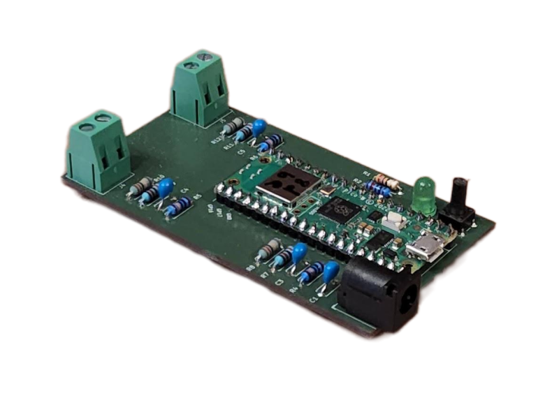

# Leak Cube

**Two-channel, wireless water-leak detection for wide-area coverage in remote equipment spaces, tunnels, basements, and other hard-to-reach locations.**

| Enclosure | PCB | Installation |
|-------------|---|--------------|
|  |  |  |

## Overview

The Leak Cube is a compact, wireless instrumentation module in the Blinky-Lite Instrumentation Platform. It is designed to detect water leaks using long, low-cost resistive wire detectors, then communicate leak states and alarms to a central Blinky-Lite control system.

Each detector strip consists of two parallel thin stainless-steel wires embedded in a plastic mesh. When water bridges the wires, the resistance between them drops and the Leak Cube detects a leak. The strips can be many metres long, providing broad coverage along floors, cable routes, tunnels, basements, and other remote locations.

The high-impedance measurement network is sensitive to impedances on the order of 10 MΩ. This enables detection of small conductivity changes while also helping identify an open circuit caused by a damaged or cut detector strip.

Built around the Raspberry Pi Pico W / RP2040, the module uses 2.4 GHz Wi-Fi and MQTT publish/subscribe communication. This event-driven approach supports distributed deployments without wired data connections and enables Blinky-Lite to use device information for recording, notifications, visualisation, and machine-protection workflows.

### Key features

- Two-channel leak detection: Monitor two independent resistive water-leak detector strips.
- Wide-area coverage: Low-cost parallel-wire detector strips can extend for many metres to cover long or remote areas.
- High-impedance measurement: Detect impedances on the order of 10 MΩ for sensitive leak detection.
- Detector-integrity indication: Identify open-circuit conditions that can indicate a damaged or cut detector strip.
- Remote deployment: Wireless communication supports placement in out-of-the-way areas such as tunnels and basements.
- PLC-style field wiring: 5 mm screw terminals simplify connection of detector strips in practical field installations.
- Event-driven integration: MQTT publish/subscribe communication with Blinky-Lite for prompt leak and detector-fault reporting.
- Open-source firmware: Microcontroller code can be adapted for site-specific instrumentation and integration requirements.

### Technical summary

| Specification | Details |
|---------------|---------|
| Primary function | Resistive water-leak detection and detector-integrity monitoring |
| Sensor / interface | Parallel thin stainless-steel wire detector strips embedded in plastic mesh |
| Channels | Two independent leak-detection channels |
| Detection principle | Water bridging parallel detector wires lowers the measured resistance |
| Measurement sensitivity | Impedances on the order of 10 MΩ |
| Detector coverage | Detector strips can be many metres long |
| Detector integrity | Open-circuit detection can indicate a damaged or cut wire detector |
| Inputs / outputs | 5 mm screw terminals for two-wire detector-strip connections |
| Power input | 5 V DC via 2.1 mm barrel connector |
| Wireless | 2.4 GHz Wi-Fi |
| Communication | MQTT publish/subscribe protocol |
| Controller | Raspberry Pi Pico W / RP2040 |
| PCB dimensions | 48 mm × 86 mm |
| Enclosure and mounting | 53 mm × 93 mm × 25 mm; DIN Mod3-compatible enclosure with removable DIN-rail mount |
| Platform | Blinky-Lite Instrumentation Platform |

### Typical applications

- Water-leak monitoring in tunnels and basements
- Leak detection beneath equipment, piping, and utility installations
- Remote monitoring of cable routes and service areas
- Distributed facility monitoring requiring central visibility
- Leak alarms and machine-protection workflows

## Getting started

### Hardware

1. Install the Leak Cube close to the detector strips or area being monitored.
2. Route each parallel-wire detector strip across the area requiring leak coverage.
3. Connect each detector strip to its assigned 5 mm screw terminals according to the product wiring documentation.
4. Connect the cube to a regulated 5 V DC supply through the 2.1 mm barrel connector.
5. Verify the detector-strip condition and confirm that each channel reports normal, leak, and open-circuit states as expected.
6. Mount the enclosure on a DIN rail when required, or remove the DIN-rail mount for an alternative installation.

### Firmware build target

The firmware targets the Raspberry Pi Pico W / RP2040 using the Arduino-Pico board support.
- Board: Pico W / RP2040-compatible target
- Flash layout: Sketch 1920 KB, filesystem 128 KB
- FQBN flash option: flash=2097152_131072

### Open-source software and licensing

The firmware is released under the MIT License, giving users broad permission to study, modify, and adapt the code for their own applications. The open hardware design can likewise be customised to suit site-specific requirements. The firmware uses the open-source Arduino-BlinkyPicoW library, which is also available under the MIT License.

### Configuration

1. Build and upload the firmware using the project’s source and configuration files.
2. Use the onboard web interface to set or update Wi-Fi credentials.
3. Configure the MQTT connection and create the corresponding device integration in Blinky-Lite.
4. Set leak and detector-integrity thresholds appropriate to each detector strip and installation environment.
5. Configure alarm thresholds and any required machine-protection or notification workflows.
6. Verify that normal, leak, and detector-fault events appear as expected in Blinky-Lite.

### Integration model

The Leak Cube uses MQTT to publish detector states, leak events, and detector-fault events. This event-driven model avoids conventional polling and enables prompt control-system responses to changing conditions.

In a typical deployment, the device connects by Wi-Fi to the network and communicates through an MQTT broker. Blinky-Lite represents it as an integrated instrumentation node and can use its information for recording, display, notification, alarms, and machine-protection logic.

### Measurement, safety, and installation considerations

- Confirm that detector strips, wiring, connectors, and environmental conditions are suitable for the intended installation.
- Route detector strips to provide the desired coverage while protecting them from physical damage.
- Validate normal, leak, and open-circuit behaviour before relying on the device for operational or protection decisions.
- Set thresholds appropriate to the detector length, installation environment, and required sensitivity.
- Review connector, cable, grounding, shielding, enclosure, and environmental requirements before installation.

